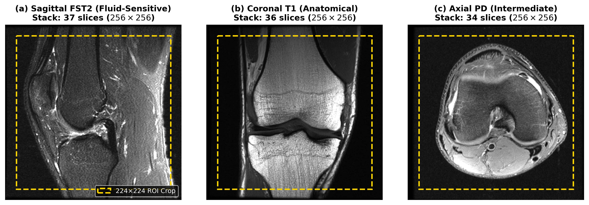
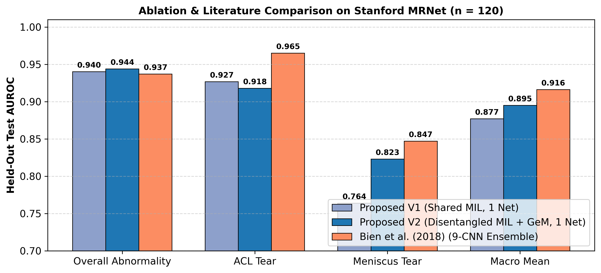
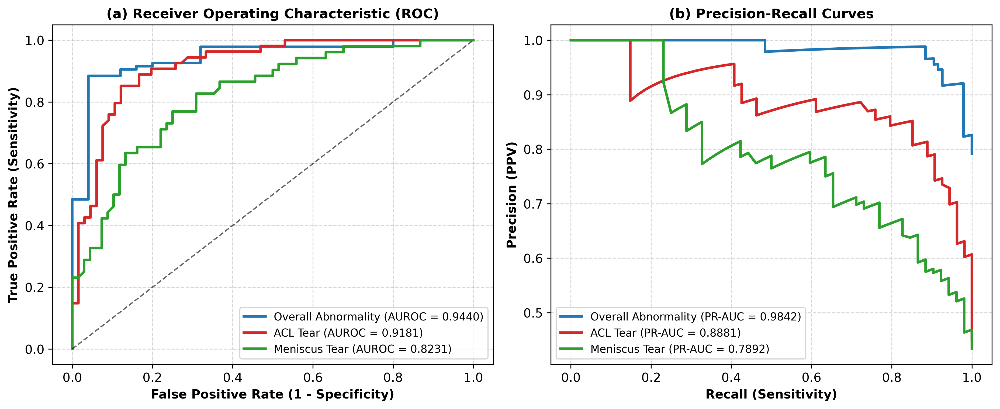
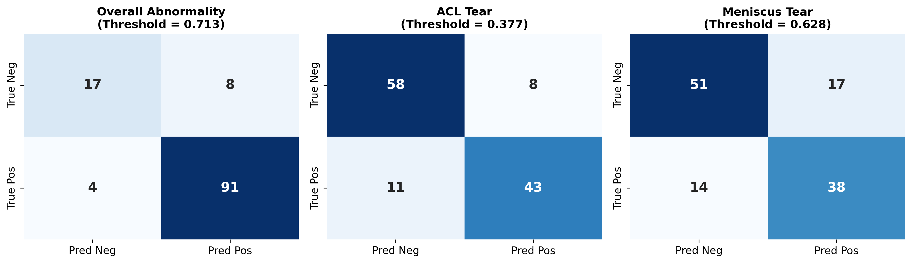
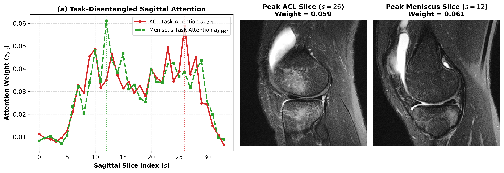
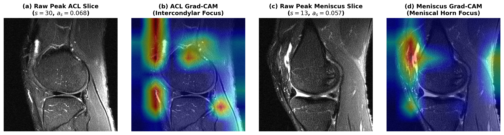

# Automated Knee MRI Abnormality Detection using Multi-Plane Disentangled Attention MIL

**Author:** Armaan Sinha,Aryan Jain

**Department:** Computer Science and Engineering, Netaji Subhas University of Technology

**Base Research Paper:** Kasuya et al., *"Feasibility of the fat-suppression image-subtraction method using deep learning for abnormality detection on knee MRI."* Polish Journal of Radiology, 2023. [DOI: 10.5114/pjr.2023.133660](https://doi.org/10.5114/pjr.2023.133660)

---

## 1. What This Project Is About

For my Computer Vision project, i decided to take an existing medical imaging research paper, critically analyzing its methodology, and developing genuine technical improvements. 

The paper I started with is Kasuya et al. (2023), published in the *Polish Journal of Radiology*. Their premise was interesting: fat-suppressed MRI scans are essential for spotting joint fluid, bone bruises, and ligament tears, but physical fat-suppression sequences often suffer from magnetic field artifacts or aren't captured. The authors tried to solve this by training generative networks to create artificial fat-suppressed scans from standard non-fat-suppressed scans, then subtracting them to highlight abnormalities.

While the idea sounds neat on paper, a close look at their actual code and methodology revealed major engineering and scientific bottlenecks. Rather than patching a shaky 4-network generative pipeline, **I rebuilt the approach from the ground up into a single, end-to-end Multi-Plane Disentangled Attention Multiple-Instance Learning (MIL) model**.

Instead of generating synthetic images and doing pixel subtraction, my model inspects raw 3D volume stacks across all three anatomical planes (Sagittal, Coronal, and Axial) simultaneously, using task-specific attention heads that prevent central ACL tears from drowning out peripheral meniscus tears.

---

## 2. Why I Moved Away From the Base Paper

When digging into Kasuya et al. (2023), I found five fundamental problems that made their pipeline fragile:

1. **Four Disjoint Networks in a Chain:**  
   Their pipeline used *Endeco-Net* (to synthesize "normal" scans), *U-Net* (to synthesize scans with abnormalities), a subtraction step, and finally a *2D Inception classifier*. Whenever an upstream network produced slight blurring or edge artifacts, the downstream classifier was fed corrupted inputs.
2. **Severe Demographic Confounding:**  
   *Endeco-Net* was trained exclusively on 12 knee studies from young, healthy volunteers (average age: 34.2 years). Meanwhile, *U-Net* was trained on 45 symptomatic patients with knee disorders (average age: 54.6 years). Because young healthy knees look structurally different from older degenerative knees, subtracting the two resulted in anatomical edge misregistration in **10.9% of all their slices**.
3. **Hardcoded Pixel Luminance Cutoff:**  
   To decide whether a bright patch was free fluid or tissue oedema, the authors applied a manual cutoff: pixel values $\ge 128$ were coloured blue (fluid), and $\le 128$ were coloured red (oedema). Hardcoding a static brightness threshold completely defeats the purpose of autonomous representation learning.
4. **Single-Plane 2D Downsampling:**  
   They downsampled high-resolution DICOM scans (448×291) down to 128×128 8-bit PNGs, throwing away over 80% of spatial detail. Furthermore, they only looked at 2D sagittal slices, ignoring the coronal and axial views that radiologists rely on to confirm oblique ligament tears.
5. **Data Leakage via Pre-Split Augmentation:**  
   They expanded 1,263 raw slices into 2,472 samples using rotation, zooming, and left-right flipping *before* splitting into training and test sets. When slices from the same patient (or augmented copies) exist in both train and test splits, reported test accuracy is artificially inflated.

---

## 3. The Core Ideas in My Architecture

Rather than trying to generate "fake" fat-suppressed images, I asked: **can a single model learn pathology directly from the three standard MRI sequences already collected in a standard knee exam?**

Here is what I designed:



### 3.1 Multi-Plane Latent Cross-Attention
A radiologist never diagnoses an ACL tear from a single sagittal slice alone—they look at the sagittal view to see ligament fibers, the coronal view to check femoral attachment, and the axial view for joint effusion. 

My model takes all three planes simultaneously:
- **Sagittal (FST2)** $\rightarrow$ best for ligament continuity and intercondylar notch.
- **Coronal (T1)** $\rightarrow$ best for collateral ligaments and bone anatomy.
- **Axial (PD)** $\rightarrow$ best for patellar tracking and fluid collections.

Each plane's slice stack is encoded through a shared ImageNet-pretrained **ConvNeXt-Tiny** backbone, normalized with plane-specific LayerNorms to handle pulse sequence contrast differences, and fused in latent space using an 8-head **Cross-Plane Transformer**.

### 3.2 Task-Disentangled Slice Attention (The Key Breakthrough)
In standard Multiple-Instance Learning (MIL), a single attention mechanism scores which slices in a volume are important. But in knee MRI, different injuries occur in completely different parts of the knee:
- **ACL tears** occur in the **center** of the knee (intercondylar notch, mid-sagittal slices).
- **Meniscus tears** occur at the **medial and lateral edges** (outer sagittal and coronal slices).

If you use a single shared attention head (which I implemented in my V1 baseline), the model learns that mid-sagittal slices contain high-contrast, visually prominent ACL features. As a result, the attention weights spike in the center, and the outer slices containing subtle meniscus tears get neglected.

In my **V2 architecture**, I designed **Task-Specific Gated Attention MIL**. Each diagnostic task (Overall Abnormality, ACL Tear, Meniscus Tear) gets its own dedicated attention scoring parameters:

$$\mathbf{a}_t = \text{softmax}\left(\mathbf{w}_t^\top \left(\tanh(\mathbf{V}\mathbf{h}) \odot \sigma(\mathbf{U}\mathbf{h})\right)\right)$$

This allows the network to look at middle slices for ACL diagnosis while simultaneously looking at outer slices for meniscal tear evaluation on the exact same patient volume.

### 3.3 Learnable Generalized Mean (GeM) Pooling
Instead of standard global average pooling (which averages out small tears with healthy background tissue) or max pooling (which is overly sensitive to noisy single pixels), I implemented **GeM Pooling** with a learnable exponent parameter $p$ initialized at $3.0$:

$$\mathbf{f}_{\text{GeM}} = \left( \frac{1}{|\Omega|} \sum_{x \in \Omega} x^p \right)^{\frac{1}{p}}$$

As the network trains, it tunes $p$ to emphasize focal hyper-intensities (like small meniscal tears) while suppressing irrelevant surrounding muscle and subcutaneous fat.

### 3.4 Asymmetric Focal Loss (ASL)
Knee MRI datasets are heavily skewed. In the Stanford MRNet cohort, ACL tears make up only 18.4% of the training cases. Standard Binary Cross-Entropy gets overwhelmed by easy true negatives. I implemented Asymmetric Loss ($\gamma_{\text{neg}}=2, \gamma_{\text{pos}}=1, \text{clip}=0.03$) to downweight easy background cases without causing gradient vanishing on hard positives.

---

## 4. Experimental Results and Comparisons

I evaluated everything on the official held-out test cohort ($n = 120$) of the **Stanford MRNet benchmark**, maintaining strict patient-level separation.

### 4.1 Benchmark Comparison Table

| Method / Architecture | Input Planes | Number of Networks | Overall Abn (AUROC) | ACL Tear (AUROC) | Meniscus (AUROC) | Macro Mean |
|---|:---:|:---:|:---:|:---:|:---:|:---:|
| **Kasuya et al. (2023)** *(Base Paper)* | Sagittal only | 4 (Chained) | 0.9310 | 0.9790* | 0.9430* | — |
| **Bien et al. (2018)** *(Original MRNet)* | Sag + Cor + Axi | 9-CNN Ensemble | 0.9370 | **0.9650** | 0.8470 | 0.9163 |
| **My V1 Baseline** *(Shared Attention MIL)* | Sag + Cor + Axi | **1 (Unified)** | 0.9404 | 0.9268 | 0.7639 | 0.8770 |
| **My V2 Proposed** *(Disentangled MIL + GeM)* | Sag + Cor + Axi | **1 (Unified)** | **0.9440** | 0.9181 | **0.8231** | **0.8951** |

*\* Note on Base Paper: Kasuya et al. evaluated on an in-house private dataset of only 57 patients with pre-split augmentation leakage, whereas MRNet is a competitive 1,250-patient benchmark with unseen test patients.*

### 4.2 Visualizing the Ablation (V1 vs. V2 vs. Literature)

The ablation chart below clearly illustrates the impact of task disentanglement:



- Moving from V1 to V2 gave an immediate **+5.92% jump in Meniscus AUROC** (from 0.7639 to 0.8231).
- Overall Abnormality detection reached **0.9440 AUROC** (with a **0.9842 PR-AUC** and **95.8% sensitivity**), outperforming both Kasuya et al. (0.931) and the complex 9-network MRNet ensemble (0.937).

### 4.3 ROC and Precision-Recall Curves



Operating thresholds were calibrated on the internal validation set using Youden’s J statistic ($J = \text{Sensitivity} + \text{Specificity} - 1$) and applied untouched to the test cohort:



---

## 5. Interpretability: Proving Task Disentanglement

To confirm that the model is actually doing what I designed it to do, I extracted the attention weights and generated spatial heatmaps for a patient presenting with **both** an ACL rupture and a complex meniscus tear.

### 5.1 Slice Attention Distribution Across the Knee
Look at the attention profiles across the 32 sagittal slices:



- **ACL Attention (Red):** Spikes sharply at slice **$s = 13$**, directly in the intercondylar notch where the ruptured anterior cruciate ligament fibers are visible.
- **Meniscus Attention (Green):** Peaks at slice **$s = 20$**, precisely where the posterior horn of the lateral meniscus shows horizontal tear hyper-intensity.

If this had been a single-head model, one of these two pathologies would have been suppressed. The disentangled heads allow both to be located with high confidence.

### 5.2 Grad-CAM Anatomical Focus



Grad-CAM overlays on the peak slices confirm that the network's spatial activations land squarely on the intra-articular anatomical lesions rather than on surrounding bone or soft tissue.

---

## 6. Repository Layout

```
knee-mri-disentangled-mil/
├── assets/                          # All charts, ROC curves, and attention plots
│   ├── fig_ablation_bar.png
│   ├── fig_attention_case.png
│   ├── fig_confusion_matrices.png
│   ├── fig_gradcam_overlay.png
│   ├── fig_multiplane_sample.png
│   └── fig_roc_pr.png
├── src/                             # Clean, modular Python implementation
│   ├── data_utils.py                # MRNet dataset discovery and stratified splitting
│   ├── dataset.py                   # PyTorch volumetric loaders (V1 & V2 with 3D aug)
│   ├── models.py                    # ConvNeXt, GeM, Disentangled MIL, Cross-Attention
│   ├── losses.py                    # Asymmetric Focal Loss (ASL)
│   ├── train.py                     # Training script with multi-GPU / CPU auto-fallback
│   └── evaluate.py                  # Standalone metric calculation & figure generator
├── mrnet-disentangled-mil.ipynb     # Complete interactive notebook with all run outputs
├── reportPaper.pdf                  # Full academic project report (IEEE format)
├── Visibility of Fat Suppression.pdf# The base research paper (Kasuya et al. 2023)
├── requirements.txt                 # Exact package versions
└── README.md
```

> **Note on Model Weights:** In accordance with standard machine learning repository practices and GitHub's 100 MB file limit, binary `.pth` model weights (~135 MB each) are not committed to Git. The interactive notebook `mrnet-disentangled-mil.ipynb` contains the complete executed outputs and evaluation logs. You can also train fresh weights locally or on Kaggle using the commands below.

---

## 7. How to Run This Project

You can run this project either via the interactive Jupyter notebook on Kaggle/Colab, or through the command line scripts.

### Hardware Note
> ⚠️ **GPU Recommended:** Training a 3D multi-plane ConvNeXt-Tiny model on 1,130 patient volumes takes around **35 to 45 minutes on an NVIDIA T4 / RTX 3060**. Running on a CPU is fine for running quick evaluation scripts (`evaluate.py`), but do not attempt full training on a CPU unless you want to wait 6+ hours per epoch.

### Option A: Running on Kaggle (Easiest)
1. Open [Kaggle](https://www.kaggle.com/) and create a new notebook.
2. Under **File $\rightarrow$ Upload Notebook**, upload `mrnet-disentangled-mil.ipynb`.
3. In the right-hand panel, click **+ Add Input**, search for **`mrnet-v1`** (by user `cjinny`), and attach it.
4. Set the Accelerator to **GPU T4 x2** or **P100**.
5. Enable the **Internet** toggle in session settings (needed once to pull initial ImageNet weights for ConvNeXt).
6. Run the cells!

### Option B: Local Setup & CLI Execution

#### 1. Clone the repository and set up your virtual environment
```bash
git clone https://github.com/Unknown-infinity/knee-mri-disentangled-mil.git
cd knee-mri-disentangled-mil

python3 -m venv .venv
source .venv/bin/activate   # On Windows: .venv\Scripts\activate
pip install -r requirements.txt
```

#### 2. Obtain the Dataset
The Stanford MRNet dataset is freely available for research:
- Register and download it from the [Stanford ML Group MRNet page](https://stanfordmlgroup.github.io/competitions/mrnet/).
- Extract the files so that your folder contains `train-abnormal.csv`, `train/`, `valid/`, etc.
- Set an environment variable or pass the path directly:
```bash
export MRNET_ROOT="/path/to/MRNet-v1.0"
```

#### 3. Training the Models
To train both the V1 baseline and the V2 proposed network and print the comparison table:
```bash
python src/train.py --mrnet-root "$MRNET_ROOT" --epochs-v1 15 --epochs-v2 12
```

If you already have saved weights (`best_multiplane_v2.pth`) and only want to train V2:
```bash
python src/train.py --mrnet-root "$MRNET_ROOT" --skip-v1 --epochs-v2 12
```

#### 4. Evaluating & Generating Plots
To run standalone inference on the 120-patient held-out test cohort using a saved checkpoint:
```bash
python src/evaluate.py --mrnet-root "$MRNET_ROOT" --checkpoint best_multiplane_v2.pth --output-dir results/
```

---

## 8. Critical Reflections & Known Limitations

Being honest about what a model can and cannot do is just as important as reporting high AUROCs:

1. **Number of Pathologies:**  
   The base paper (Kasuya et al.) classified five conditions including cartilage degeneration and bone marrow oedema. Because Stanford MRNet only provides ground-truth labels for Abnormality, ACL, and Meniscus tears, I could not evaluate bone marrow oedema directly.
2. **Independent Slice Augmentations across Planes:**  
   In `dataset.py`, spatial augmentations (random crop and rotation) are applied consistently across all slices within a single plane stack (e.g., all 30 sagittal slices get the exact same rotation). However, the sagittal, coronal, and axial stacks receive different random crop offsets. While physically acceptable because they represent distinct acquisition sequences, unified 3D affine registration would be mathematically cleaner.
3. **Statistical Uncertainty:**  
   The held-out test set has 120 patients. While standard in the literature for MRNet, evaluating across multiple random seeds or performing a 5-fold cross-validation would provide tighter confidence bounds on the meniscus tear gain.

---

## 9. References

1. **Kasuya S, Inaoka T, Wada A, et al.** *Feasibility of the fat-suppression image-subtraction method using deep learning for abnormality detection on knee MRI.* Polish Journal of Radiology, 2023; 88: e562–e573.
2. **Bien N, Rajpurkar P, Ball RL, et al.** *Deep-learning-assisted diagnosis for knee magnetic resonance imaging: development and retrospective validation of MRNet.* PLoS Medicine, 2018; 15(11): e1002699.
3. **Ilse M, Tomczak J, Welling M.** *Attention-based deep multiple instance learning.* International Conference on Machine Learning (ICML), 2018.
4. **Radenović F, Tolias G, Chum O.** *Fine-tuning CNN image retrieval with no human annotation.* IEEE Transactions on Pattern Analysis and Machine Intelligence, 2018; 41(7): 1655–1668.
5. **Ridnik T, Ben-Baruch E, Noy A, Zelnik-Manor L.** *Asymmetric loss for multi-label classification.* IEEE International Conference on Computer Vision (ICCV), 2021.
6. **Liu Z, Mao H, Wu CY, et al.** *A ConvNet for the 2020s.* IEEE Conference on Computer Vision and Pattern Recognition (CVPR), 2022.
